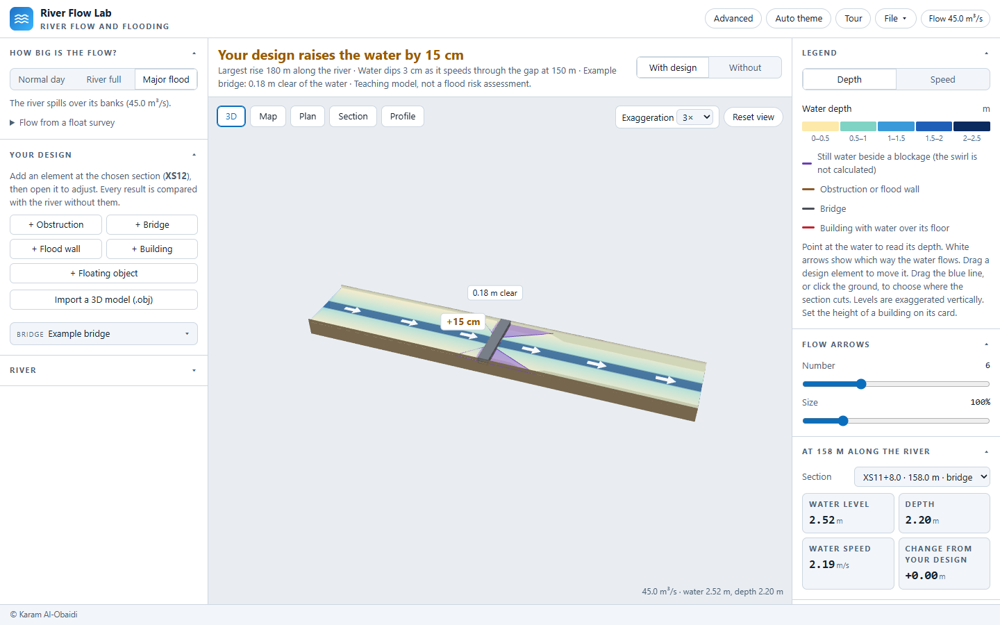
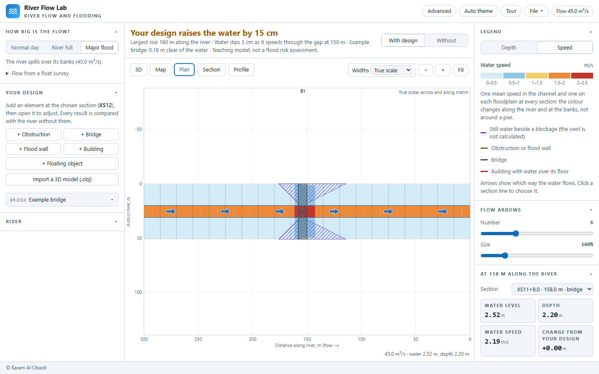

# River Flow Lab

A single-file browser tool for teaching how river flow, water level,
obstructions and bridges interact, for architecture and urban design
students. The first site is a reach of the River Sheaf at Heeley,
Sheffield.

**Status: in development, before the first release (1.0.0).** The engine
and the interface work on a template reach, a river drawn on the map or
taken from OpenStreetMap, a terrain model, or sections you type in. The
River Sheaf site data follows.





More in [`docs/`](docs/): the Section and Profile views, the guided tour
and the phone layout. `node tools/make-screenshots.mjs` remakes them all
from `index.html`.

## Using it

Open `index.html` in a browser; it needs no installation or account. The
calculation, the views and loading your own files work with no network;
the map, place search and finding rivers on OpenStreetMap need one, and
only ask for it when used. The layout follows Urban Wind Lab: controls on
the left, one large
view in the middle, results on the right. It starts on a template reach (an
idealised channel with floodplains, not a survey) with one example bridge.

- **Basic and Advanced:** the app opens in Basic, with plain words, the flow
  choices and the design tools. The *Advanced* button at the top (or `#advanced`
  on the address) shows every setting, result and technical term.
- **Placing a design element:** in Basic, press its button, then click where it
  goes in the 3D view. In Advanced it is added at the chosen section.
- **Main result** (above the view): how much the design changes the water,
  which buildings flood and how clear each bridge is. *With design* and
  *Without* switch the 3D, Plan, Section and Profile views between the two.
- **Flow** (left): pick Normal day, River full or Major flood (river full is
  found at the chosen section). In Advanced, type or drag the flow and add a climate
  allowance in per cent. The slider's range grows with the flow. The
  downstream boundary is not shown: the water level at the downstream end is
  normal depth on the river bed's own fall there, which every kind of reach
  sets (template, drawn or terrain), and the CSV header records it.
  *Flow from a float survey* works out the flow from a site survey: channel
  width and mean depth, and the time a float takes over a measured distance.
  The mean speed is taken as 0.85 of the float's (changeable), and the flow
  as mean speed × width × depth. *Use this flow* sets it, and the app then
  compares its own channel speed at the chosen section with the survey's.
- **Design** (left): add an obstruction, bridge, flood wall or building at
  the chosen section, then open it to set its size and levels. Eddy zones
  (the dead water beside and behind a blockage) can be resized or switched
  off.
- **Your own model:** *Import a 3D model (.obj)* in Design brings in a mesh, up
  to 30,000 triangles. It is treated as solid from the ground up to its top.
  Drag it in 3D to move it, and use its Rotation slider to turn it. The file
  stays in the browser and is kept in a saved project.
- **Floating objects:** *+ Floating object* in Design adds a moored box, and an
  imported model can be set to float. It rises and falls with the water; only
  the part below the water blocks the flow, and water passes underneath. It
  cannot drift, because the model is steady. Give its depth below the water
  directly, or its weight in tonnes: a box sinks until it pushes aside its own
  weight of water, so depth = weight ÷ (1 t/m³ × length × width). Its
  underside adds friction like an ice cover, at the roughness of a smooth hull
  (Manning's n 0.013, changeable in Advanced), combined with the bed's by
  Horton's rule.
- **River from a terrain model:** *Build from a terrain model (.tif, .asc or .obj)* in River
  shows the model from above. Click along the river from upstream to
  downstream; sections are cut square to the line. Most terrain models do not
  record the river bed, so a channel of the depth and width given is carved in
  and the reach is labelled as estimated. The file stays in the browser.
  A terrain file in another grid is not placed on the map. An ASC file cannot
  say which grid it uses, so British National Grid is assumed and the window
  says so.
  GeoTIFF and ASC tiles in British National Grid, such as the Environment Agency 1 m LIDAR
  DTM, keep their real position, so places can be marked by coordinates or a
  map link. Widths and depths measured on site can replace the estimates.
- **River** (left): the active reach, a new template reach, and the
  cross-section editor.
- **Map** (middle): find a place (or type coordinates), press *Draw the
  river* in the River section, and click along the river from upstream to
  downstream. *Build reach from line* cuts sections square to the line at
  the spacing you set; the line's corners are rounded first, and on a bend
  each overbank gets its own reach length. The levels come from the
  template shape until surveyed levels are entered, and the reach says so.
- **Rivers from OpenStreetMap:** in the Map view, *Find rivers here* loads
  the rivers and streams in view (up to 3 km across). Click one, then click
  where your reach starts and ends. OpenStreetMap draws waterways in the
  direction of flow, so that sets which end is upstream whatever order you
  click in. The reach is named after the river and credited to OpenStreetMap
  (ODbL) on screen and in every export. Where the river runs in a culvert,
  the app says at which chainages, and suggests modelling it as a bridge.
- **Views** (middle): 3D, Map, Plan, Section and Profile, one at a time.
  On a drawn river the 3D view follows its course. In 3D, drag a design
  element to move it (its levels move with the river bed), and drag the
  blue section line, or click the ground, to choose where the section cuts.
  Plan has a true-scale option, zoom and pan, like Section and Profile.
  In 3D and Plan the legend switches the water's colour between depth and
  speed. A 1D model has one mean speed in the channel and one on each
  floodplain at a section, so the colour changes along the river and at the
  banks, not around a pier.
- **Results** (right): the legend for the view, tiles for the chosen
  section, the effect of the design (afflux, soffit clearance, floor levels,
  choking), water level against flow, and every section in a table.
  The effect of the design also names where scour and settling are most
  likely, from the channel speeds alone: sections 1.5 times faster or 0.6
  times slower than the reach's typical speed, places where the design
  changes the speed by 10% or more, and wet eddy zones. Sediment itself is
  not modelled, and the app says so.
- **File** menu: export the view as PNG, the results as CSV, and save or
  open a project. Every export carries the caution and the settings.

On a phone the view sits on top, with Controls and Results beneath.

## What it stores and what it contacts

- **Browser storage:** the colour theme (`riverflowlab.theme.v1`) and, if
  you set one, a custom map tile service (`riverflowlab.basemap.custom.v1`).
- **OpenStreetMap tiles** (`tile.openstreetmap.org`): the map area on
  screen, only while the Map view is open; at most 6 × 6 tiles, never
  prefetched. A custom tile service replaces them if you set one.
- **Nominatim** (`nominatim.openstreetmap.org`): the search text, only when
  you search for a place by name; typed coordinates are never sent. At most
  one request a second.
- **Overpass** (this site's `overpass-proxy.php` if installed, otherwise
  `overpass-api.de` and `overpass.private.coffee`): the map area in view,
  only when you press *Find rivers here*.
- Nothing else. Files you open are read in the browser and never uploaded.

## Deploying the rivers proxy

`server/overpass-proxy.php` is optional. Uploaded beside `index.html` (or at
the top of the site, where the host will not run PHP in subfolders), it lets
the page ask its own site for the rivers: a network that blocks the Overpass
servers no longer matters, each answer is kept for 30 days, and a class
loading together costs one request. It accepts only a box from a page on the
same site, writes the query itself, and needs no key. Ported from Solar
Analysis Lab's buildings proxy; `tests/overpass-proxy.mjs` checks it under
`php -S` against a stand-in Overpass.

**Teaching model — not a flood risk assessment.** Do not use its figures
for planning, insurance or construction decisions.

## Method

Steady, one-dimensional, subcritical flow, solved section by section with
the standard-step method (Chow 1959, ch. 10; HEC-RAS Hydraulic Reference
Manual, ch. 2 and 5):

- Manning friction with the section split into left overbank, channel and
  right overbank; average-conveyance friction slope; discharge-weighted
  reach lengths; contraction and expansion losses.
- **Obstructions** as blocked areas: the ground under them is raised, so
  the section loses area and gains wetted perimeter.
- **Bridges** by the energy method through the opening, with the soffit
  closing the section when the water reaches it (pressure flow), and the
  soffit acting only where the deck is. When the water above the bridge is
  higher than the deck, the flow divides between the opening and a
  broad-crested weir over the deck (coefficient 1.44, drowned by the level
  below as Villemonte, 1947) until both give the same level upstream. The
  weir head is the depth of water over the deck, without the approach
  velocity head, which errs towards a higher level. Yarnell's pier equation
  is reported as a check.
  Afflux is measured against the same river without the bridge.
- **Eddy zones**: the dead water beside and behind an obstruction or
  bridge, sized by the expansion (1:ER) and contraction (1:CR) ratios and
  carrying no flow below the top of the blockage. When the water rises
  above it, the dead water stays still and only the layer above it flows,
  as its own part of the section, so the zone clears gradually rather than
  all at once. The swirl inside them is not computed.
- Levees and ineffective areas carry no flow until overtopped. Low ground cut
  off from the channel by higher natural ground carries no flow either, and is
  shown dry, until the water rises over the ground between. A flood wall
  protects a building only at the wall's own chainage; where the floodplain
  just past an open end of the wall is wet, the building counts as reached,
  as a 1D model cannot follow water round the end.

## three.js

The 3D view uses three.js (MIT), bundled into `index.html` so the page
needs no network. To update it, change the pinned version in
`package.json`, then:

```bash
npm install
```

```bash
node tools/build-three.mjs
```

The licence notice is in `NOTICE`.

## Checks

```bash
npm test
```

`tools/check-release-metadata.mjs` runs first: the release guard (22
checks). It holds the version, the release date, the title, the repository
and the DOI to one value across `CITATION.cff`, `.zenodo.json`,
`package.json`, `package-lock.json`, the app (`VERSION`, `RELEASED`, its
citation) and both method-notes pages. `tests/release-guard.test.mjs` (25
checks) proves each of its checks by breaking it. Then
`tests/engine.test.mjs` (65 checks), `tests/overpass-proxy.mjs` (19 checks;
skipped where PHP is not installed) and `tests/ui.test.mjs` (252 checks,
headless Chromium with WebGL through SwiftShader; every off-origin
request is refused, except map tiles, place search and Overpass, which are
answered from local fixtures in `tests/fixtures/`; the Overpass fixture is
synthetic, not OpenStreetMap data).

The engine checks compare the engine with closed-form results (Manning
normal depth, critical depth) and with an independent RK4 integration of the
gradually varied flow equation. Agreement shows the engine is consistent
with open-channel theory; it is not validation against measured levels.

### Stamping a release

Set the new version, and the release date as `yyyy-mm-dd`, in
`CITATION.cff` (`version`, `date-released`), `.zenodo.json`, `package.json`
and `package-lock.json`, and in `index.html` (`VERSION`, `RELEASED`). In
both method-notes pages, change the byline to `Version X · d Month yyyy` and
the version in the APA and BibTeX citations. `npm test` fails until they
all agree. Once Zenodo has archived the release, add the concept and version
DOIs to `CITATION.cff` and cite the version DOI in the notes and in the
app's © card; the guard holds those together too.

## How this was developed

I design the application: I define the problem and the scope, and choose the
methods and the sources. I test it in use, find its bugs, and decide what is
released and when. The code is written with an AI coding assistant working to my
specification and direction: it writes most of the code, drafts the
documentation for my review, diagnoses bugs and proposes fixes that I test, and
writes and runs the automated tests and release checks. I retain full
intellectual responsibility for the design, the methods and the results,
including any errors.

The reasons behind the design are in [`DESIGN.md`](DESIGN.md), and how the code
is organised is in [`ARCHITECTURE.md`](ARCHITECTURE.md).

## Licence

Code: MIT (see `LICENSE`). Documentation: CC BY 4.0.
